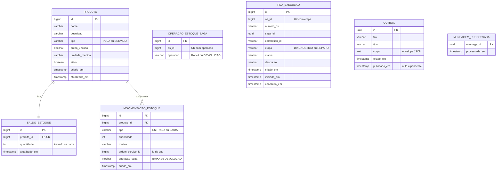

# Oficina — Execução e Produção

Microsserviço da Fase 4 do Tech Challenge: fila de execução, diagnóstico, reparo, produto e estoque. Recebe comandos da Saga pelo SQS e responde com eventos. A estratégia geral está no [OS Service](https://github.com/KauaAlmeidaSilveira/fiap-15soat-oficina-os).

- **Fila:** `GET /api/execucoes` e `POST /api/execucoes/{osId}/diagnostico|reparo/iniciar|concluir|finalizar`.
- **Estoque na Saga:** baixa tudo ou nada, com os saldos travados na transação. Baixa e devolução são idempotentes, e uma baixa atrasada depois da devolução é recusada.
- **Banco:** PostgreSQL próprio, com o saldo protegido por transação.
- **Falha simulada:** o profile `simulacao` expõe `PUT /api/simulacao/falha?ponto=ENFILEIRAR_REPARO`, nunca ativo em produção.

## Modelo de dados

PostgreSQL (`oficina_execucao`), tabelas criadas pelo Hibernate a partir das entidades JPA. Linhas cheias são
chaves estrangeiras. As referências à OS (`os_id`, `ordem_servico_id`) são ids do OS Service, sem FK.



- **Saldo e movimentação:** a baixa trava os saldos (`PESSIMISTIC_WRITE`), confere todos os itens e só então grava as
  saídas: é tudo ou nada.
- **Idempotência do estoque:** `movimentacao_estoque` é única por `(ordem_servico_id, operacao_saga, produto_id)`, e
  `operacao_estoque_saga`, por `(os_id, operacao)`. Repetir a baixa ou a devolução não move estoque de novo, e uma
  baixa que chega depois da devolução é recusada.
- **`fila_execucao`:** um item por OS e etapa, criado pelo comando da Saga e avançado pelo operador.

## Rodar os testes

Requer Java 21, Maven 3.9+ e Docker para o Testcontainers. Este serviço só valida tokens, então não usa chave privada de sessão:

```bash
openssl genpkey -algorithm RSA -pkeyopt rsa_keygen_bits:2048 | openssl rsa -pubout -out src/main/resources/jwt.public.key
mvn verify
```

## Cobertura e qualidade

O `mvn verify` falha se a cobertura de instruções do serviço inteiro ficar abaixo de 80% (JaCoCo, só
`DataLoader` e `OficinaApplication` fora da conta). O relatório fica em `target/site/jacoco/index.html`.

Execução local de 16/11/2026, na `main` (`e35c5c7`):

| Testes | Falhas | Instruções | Linhas | Ramos | Gate (80% de instruções) |
|---|---|---|---|---|---|
| 85 | 0 | 95,8% | 94,1% | 76,3% | Passou |

No SonarQube local de 17/11/2026 (`scripts/sonar-local.sh` no OS), a Execução passou no quality gate "Sonar way"
com 94,4% de cobertura e nota A em confiabilidade, segurança, revisão de segurança e manutenibilidade. Os três
serviços estão na seção "Qualidade" do [README do OS](https://github.com/KauaAlmeidaSilveira/fiap-15soat-oficina-os#qualidade-sonarqube).
O `ci.yml` roda o mesmo `mvn verify` no GitHub Actions a cada PR e push na `main` (verde desde 17/11/2026); o
passo do SonarCloud fica pulado sem o secret `SONAR_TOKEN`.


